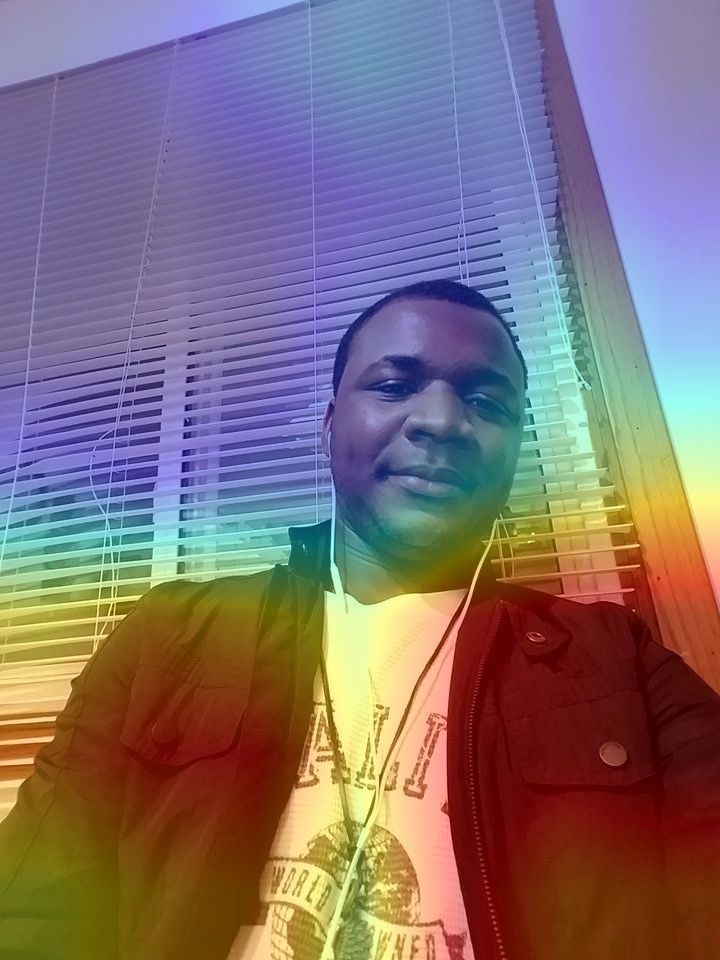
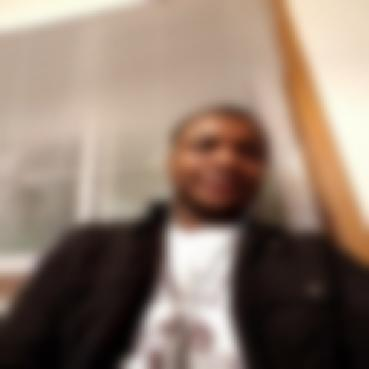
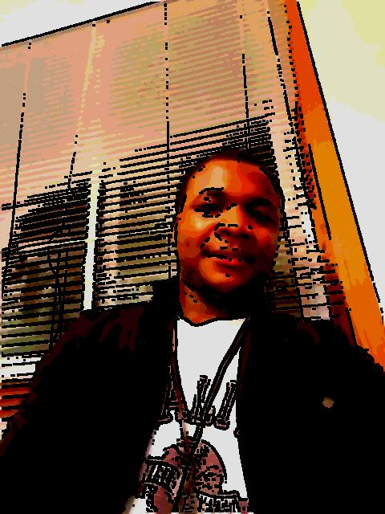

# 3.3 Image Classification and Processing: Final Report

**Student:** Trokon Reeves
**Repo:** https://github.com/Trokon123/Artificial_Intelligence_Ecosystem/tree/main/Image_Classification

## Files in this folder

| File | What it is |
|---|---|
| `base_classifier.py` | MobileNetV2 classifier with Grad-CAM added |
| `basic_filter.py` | Original blur filter plus my custom comic filter |
| `IMG-0270.JPG` | The photo I tested with |
| `IMG-0270_gradcam.jpg` | Grad-CAM heatmap over the photo |
| `IMG-0270_comic.JPG` | Output of my comic filter |
| `IMG-0270_blurred.JPG` | Output of the starter blur filter |

I ran the code in Google Colab, because Python and TensorFlow were not set up on my Windows machine and Colab already has them installed. The notebook cloned this repo and called the functions in the two files directly.

## Part 1: The classifier and Grad-CAM

### How the classifier works

`base_classifier.py` loads MobileNetV2, a neural network already trained on the ImageNet dataset, which covers 1,000 kinds of objects. The program resizes my photo to 224x224 pixels, rescales the pixel values to the range the network expects, and asks the model for a probability for each of the 1,000 classes. It then prints the three highest.

### Top-3 predictions for my photo

My photo is a selfie taken indoors in front of window blinds.

| Rank | Prediction | Confidence |
|---|---|---|
| 1 | trench_coat | 0.23 |
| 2 | suit | 0.08 |
| 3 | military_uniform | 0.06 |

### How Grad-CAM works

Grad-CAM answers the question "which part of the image made the model choose this class?" It takes the feature maps from the last convolutional layer (`Conv_1`), which still keep a 7x7 grid of positions. It then measures how much the score for the top class would change if each feature map changed (the gradient). Maps that matter more get a larger weight. The weighted maps are added together, negative values are dropped, and the result is stretched to the size of the photo and coloured from blue (ignored) to red (most important).

### What the heatmap showed

- The hottest (red) area sits in the centre of the frame, over my face and upper chest, where my collar and shirt are. It fades through yellow and green toward the edges.
- The window blinds and the upper corners stay blue, so the model mostly ignored the background.

### What I learned about the classifier's behaviour

1. **It could only answer with a label it knows.** ImageNet's 1,000 classes have no general "person" class, so the model could not say "man" or "selfie". It answered with the closest things it had, which were all clothing: trench coat, suit and military uniform. All three guesses agree with each other, which tells me it was reading the collar and shoulders area as a garment.
2. **The heatmap matches that explanation.** The model focused on the upper body, not the blinds, so it was looking at the right region for a clothing label even though the label itself is wrong. I am not wearing a trench coat.
3. **Low confidence is a signal.** The top score was only 0.23 and the next two were under 0.10. The model was spreading its guess across several similar classes. A person reading only the label "trench_coat" would be misled, but the score and the heatmap together show it was unsure.
4. **A heatmap shows where, not whether it is right.** Grad-CAM told me the model looked at a sensible place, but that did not make the answer correct. This connects to the point from the lecture that a result needs to be checked by a human and not trusted just because the system produced it.

## Part 2: Image filters

### How the starter blur works

`apply_blur_filter` opens the image, resizes it to 128x128 pixels, and applies a Gaussian blur with radius 2, which replaces each pixel with a weighted average of its neighbours. It then draws the result with matplotlib and saves it. Two things I noticed: forcing 128x128 squashes a tall photo because it ignores the original shape, and the small size is the main reason the output looks so soft.

### My custom filter: comic book

I asked the AI to modify the program to make a photo look like a comic-book panel. The filter, `apply_comic_filter`, does three things:

1. **Flat colour.** A median filter removes fine texture, then the image is posterized to 3 bits per colour channel, so smooth gradients turn into solid blocks of colour.
2. **Bold colour.** Saturation is raised to 1.8x and contrast to 1.3x so the colours look printed.
3. **Ink outlines.** The photo is converted to grayscale, edges are detected, strong edges are turned black, and the lines are thickened. The black line layer is then multiplied over the colour layer.

### Effect on my image

- The window blinds changed the most. Each slat has a sharp edge, so the filter turned the background into bold black and orange stripes, like the hatching lines in a comic.
- My skin and shirt, which had smooth shading in the photo, became a few flat patches of colour with hard borders between them.
- The warm light in the room was pushed toward strong orange and red by the saturation boost, which gives the picture a dramatic poster look.
- Fine details such as the print on my shirt were simplified, which is what a comic artist would do too.

The filter has parameters I can tune: `color_levels` (fewer levels means flatter colour), `saturation`, `contrast` and `edge_threshold` (lower means more outlines). Unlike the blur, it keeps the photo's original shape by using `thumbnail` instead of a fixed resize.

## Reflection on working with AI

I used Claude as the AI assistant for this project.

**What went well**

- The explanations of the code were clear. The Grad-CAM explanation in particular helped: describing the last conv layer as a 7x7 grid that still knows *where* things are made the heatmap make sense to me.
- The AI was upfront about what it had and had not tested. It ran the comic filter on a sample image before giving it to me, but told me it could not run the TensorFlow part in its own environment, so I knew to watch for errors there. It ran correctly the first time.
- It pointed out the reason for my odd result. I would have just thought "trench coat is wrong", but it explained that the model has no class for a person, which turned a wrong answer into something I could learn from.

**Challenges**

- Setting up was the hardest part, not the AI code. The first commands I was given were for Ubuntu, and I pasted them into Windows PowerShell, which failed on `&&`, `source` and `python3`. I had to paste the error messages back before we worked out that I was in the wrong terminal and that Python was not installed on Windows. We switched to Google Colab to get it done.
- The AI assumed my setup instead of asking first. If it had asked which terminal I had open, we would have saved time. I learned that I get better help when I tell the AI exactly what is on my screen.
- A small detail in the filter needed fixing: the edge detector drew a false black line around the border of the picture, so a step was added to paint the border white.

**What I take from it**

The AI was fastest at writing and explaining code, but it could not see my computer or my results. I had to run things, report what happened and judge whether the output made sense. That is the same human and AI collaboration we discussed in lesson 3.2: the AI did the heavy lifting, and I supplied the context and the checking.
